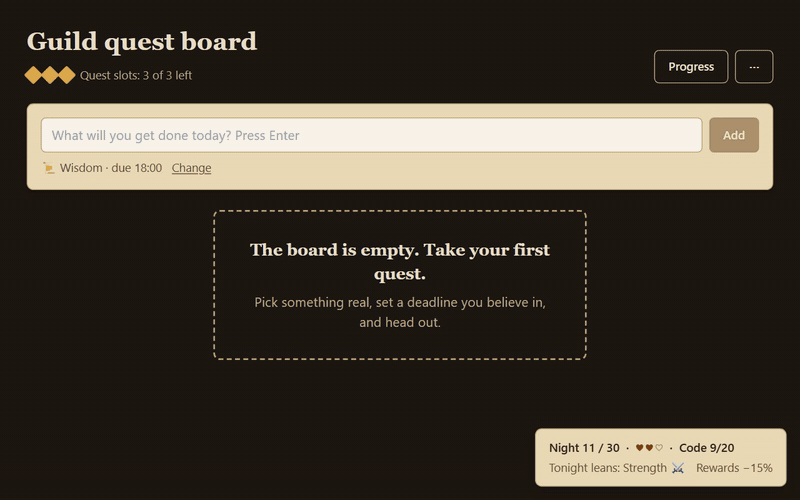
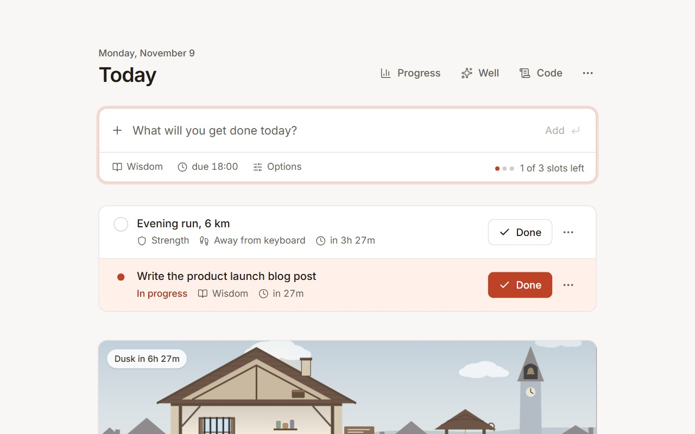
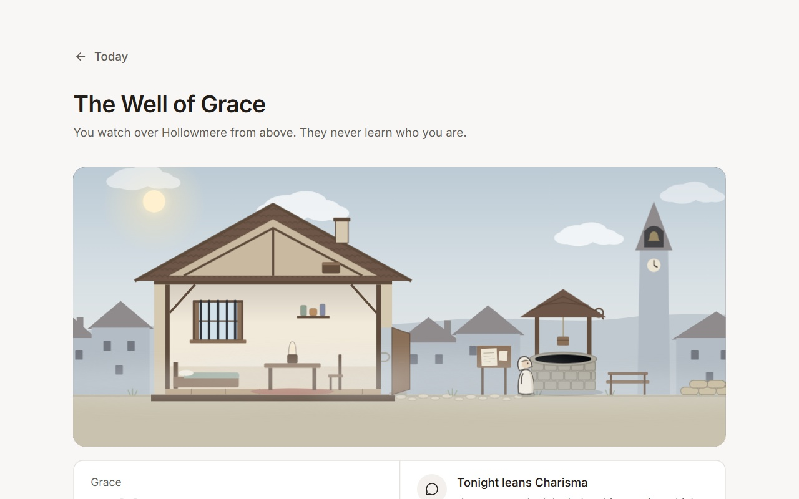
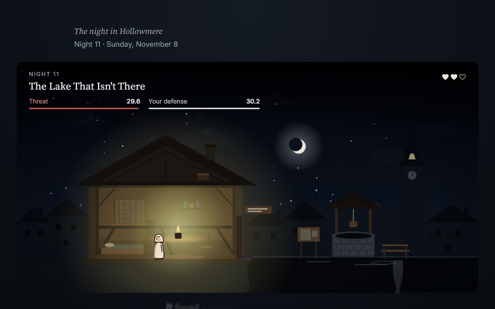
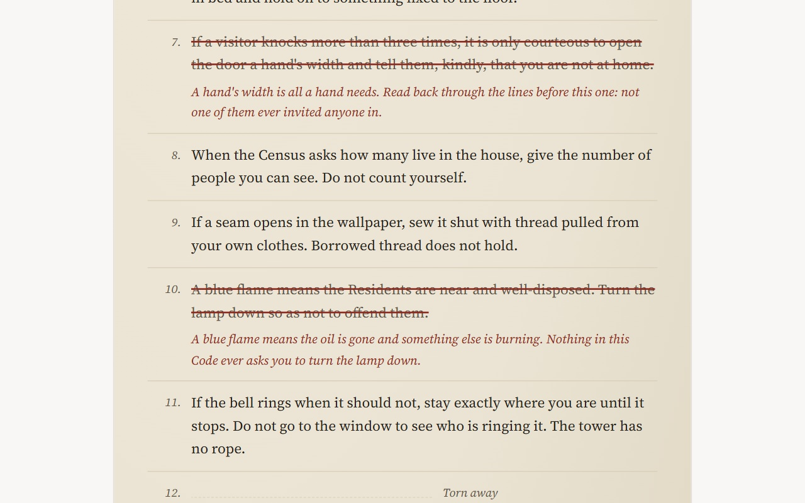
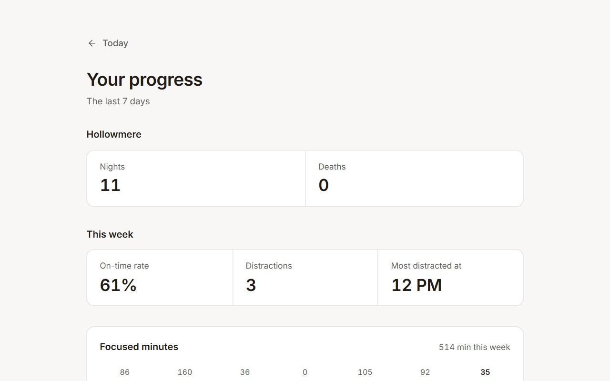
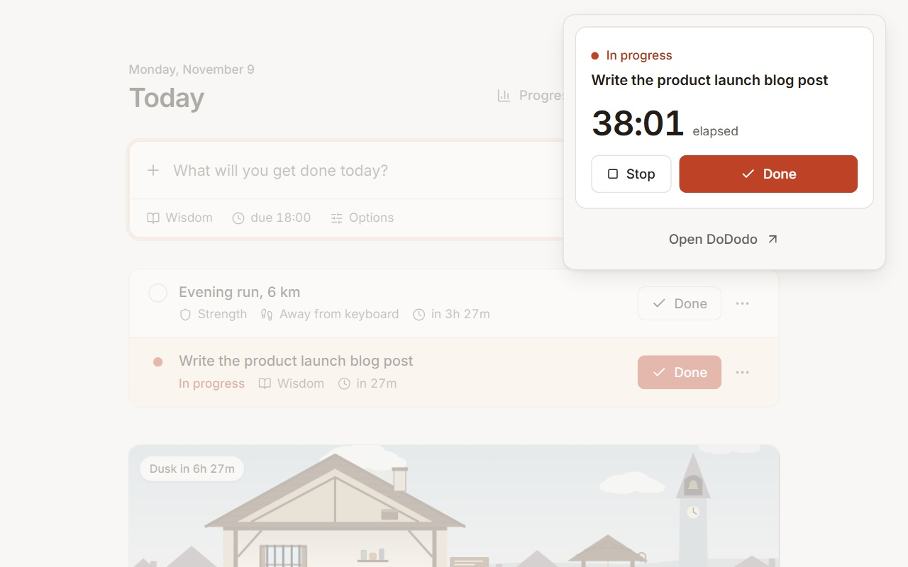

  <a href="README.md">English</a> · <a href="README.zh-CN.md">简体中文</a> · <a href="README.zh-TW.md">繁體中文</a> · <a href="README.ja.md">日本語</a> · <a href="README.ko.md">한국어</a> · <a href="README.es.md">Español</a> · <b>Français</b> · <a href="README.de.md">Deutsch</a> · <a href="README.pt-BR.md">Português (Brasil)</a> · <a href="README.ru.md">Русский</a> · <a href="README.it.md">Italiano</a> · <a href="README.ar.md">العربية</a> · <a href="README.hi.md">हिन्दी</a> · <a href="README.id.md">Bahasa Indonesia</a> · <a href="README.vi.md">Tiếng Việt</a> · <a href="README.tr.md">Türkçe</a> · <a href="README.th.md">ไทย</a> · <a href="README.pl.md">Polski</a> · <a href="README.nl.md">Nederlands</a> · <a href="README.uk.md">Українська</a>

  

<h1 align="center">DoDodo</h1>

  <b>Votre liste de tâches garde quelqu’un en vie.</b> 
  Terminez de vraies quêtes pour gagner de la Grâce, déposez des offrandes dans le Puits et aidez un survivant à traverser 30 nuits à Hollowmere. Il ne saura jamais qui l’a aidé.

  
  
  
  

  
   
  <a href="assets/demo.mp4">▶ Voir la démo complète (MP4, 58 s)</a>

## Pourquoi DoDodo

Vous prévoyez trois choses pour la journée et n’en terminez aucune. Souvent, ce n’est pas la concentration qui manque, mais une raison qui paraisse réelle *tout de suite*. Une échéance le mois prochain, c’est loin. Quelqu’un qui a besoin de vous cette nuit, non.

Dans DoDodo, chaque quête terminée devient de la Grâce pour un survivant de Hollowmere, une ville tranquille où, la nuit tombée, quelque chose vient frapper à la porte. Vous ne pouvez pas vous battre à sa place. Vous pouvez faire votre travail, choisir ce que vous envoyez au fond du Puits, et lire sa lettre le matin.

## Comment ça marche

1. **Prenez une quête** : écrivez ce que vous allez faire et appuyez sur Entrée. Trois par jour au maximum, à rendre avant la fin de votre journée de travail.
2. **Faites le travail** : pendant une quête, DoDodo note discrètement le site sur lequel vous êtes. Les quêtes loin du clavier (un footing, les courses) ne demandent aucun suivi.
3. **Gagnez de la Grâce** : un geste suffit pour terminer une quête. À l’heure, elle rapporte 2 de Grâce ; en retard, 1.
4. **Envoyez de l’aide** : dépensez votre Grâce en talismans et en constructions, puis laissez-les tomber dans le Puits de la Grâce. Au crépuscule, le survivant les remonte, remercie le ciel et affronte la nuit.

## Captures d’écran

| Les quêtes du jour | Le Puits de la Grâce |
| --- | --- |
|  |  |
| **La nuit** | **Le Code des résidents** |
|  |  |
| **Vos progrès** | **Fenêtre de la barre d’outils** |
|  |  |

## Fonctionnalités

- **Une nuit qui se regarde** : chaque nuit se joue en une courte scène animée dans la maisonnette, avec huit présences qui ont chacune leur façon d’entrer. Les chiffres restent toujours visibles : la menace de la nuit, votre défense et d’où elle vient.
- **Les choix d’un dieu** : d’en haut, vous voyez les présages que le survivant ne voit pas, et vous choisissez parmi 19 talismans et 10 constructions. Le bon cadeau, la bonne nuit : c’est ce qui le garde en vie.
- **Un Code qui ment** : les quêtes rendues à l’heure font revenir les règles de la ville. Certaines lignes sont fausses, et se fier à la mauvaise se paie.
- **Une lettre chaque matin** : le survivant écrit à la personne qui l’aide, quelle qu’elle soit. Il ne saura jamais que c’est vous.
- **Une vraie concentration, pas des cases à cocher** : un graphique de concentration sur sept jours, votre taux de ponctualité et l’heure où vous vous dispersez le plus.
- **Équitable par conception** : pas de Grâce à acheter, pas de raccourcis, pas de culpabilisation quand une série s’arrête. On ne survit qu’en faisant le travail.

## Confidentiel par conception

- Tout reste dans la base de données locale de votre navigateur. DoDodo ne se connecte jamais à Internet.
- Seul le **domaine** de l’onglet actif est enregistré, et uniquement pendant une quête : jamais d’URL complètes, de titres ni de contenu de page.
- Pas de compte, pas de statistiques, pas de publicité. Exportez ou supprimez toutes vos données depuis les Réglages.
- Politique complète: [Politique de confidentialité (en anglais)](https://github.com/hannnnnnnny/dodo-privacy/blob/main/PRIVACY.md)

## L’installer

[**Ajouter DoDodo à Chrome →**](https://chromewebstore.google.com/detail/iolnnoehfplknoagflegplkapoemiecc)  
Fonctionne dans Chrome et Microsoft Edge (version 102 ou ultérieure). L’interface est en anglais.

## À propos de ce dépôt

Ce dépôt est la vitrine publique de DoDodo : présentation, démo et captures. Le code source n’y est pas publié.  
Des idées, des bugs ou des questions ? [Ouvrez une issue](https://github.com/hannnnnnnny/DoDodo/issues) · harryhaber606@gmail.com

© 2026 DoDodo. Tous droits réservés.
