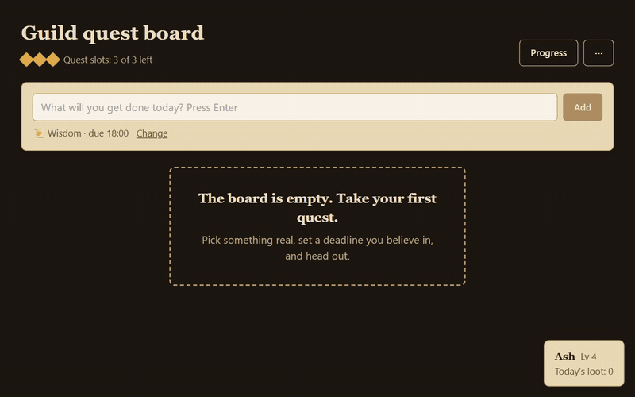
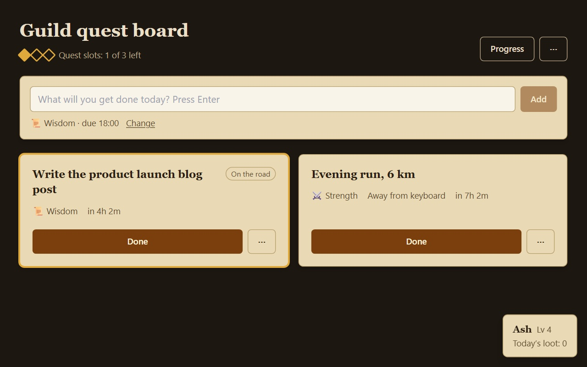
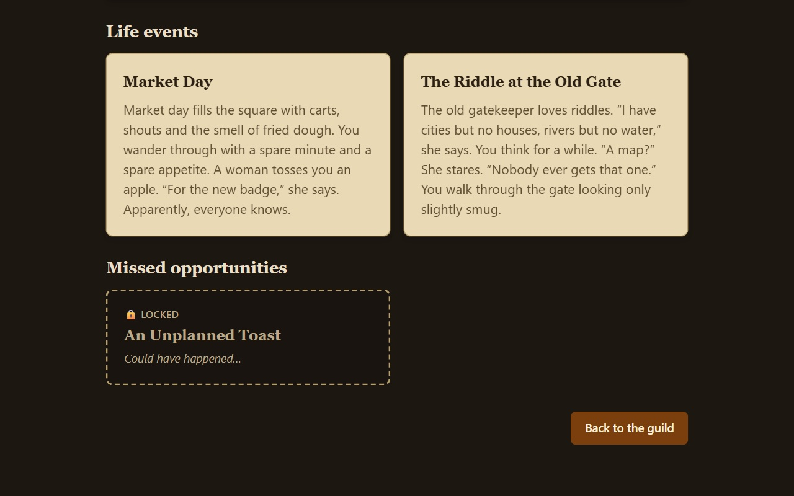
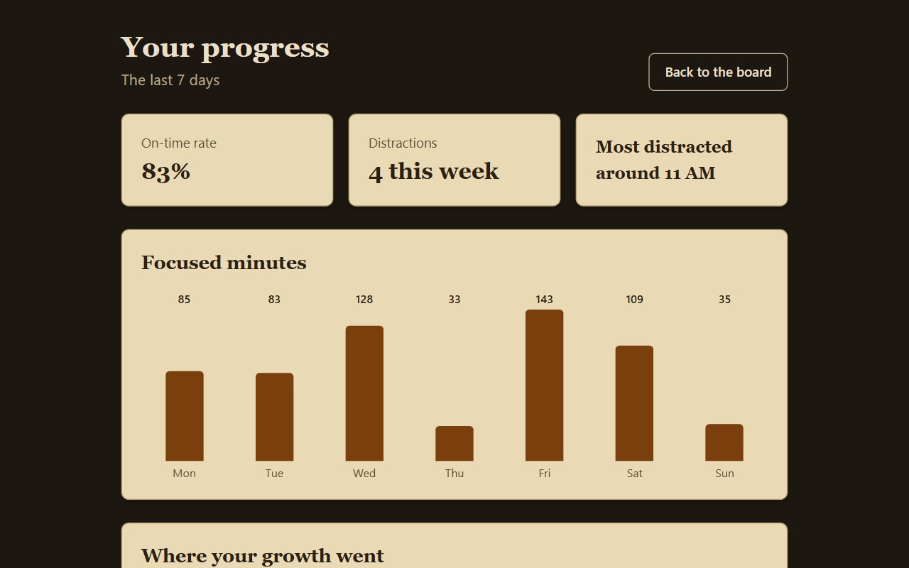
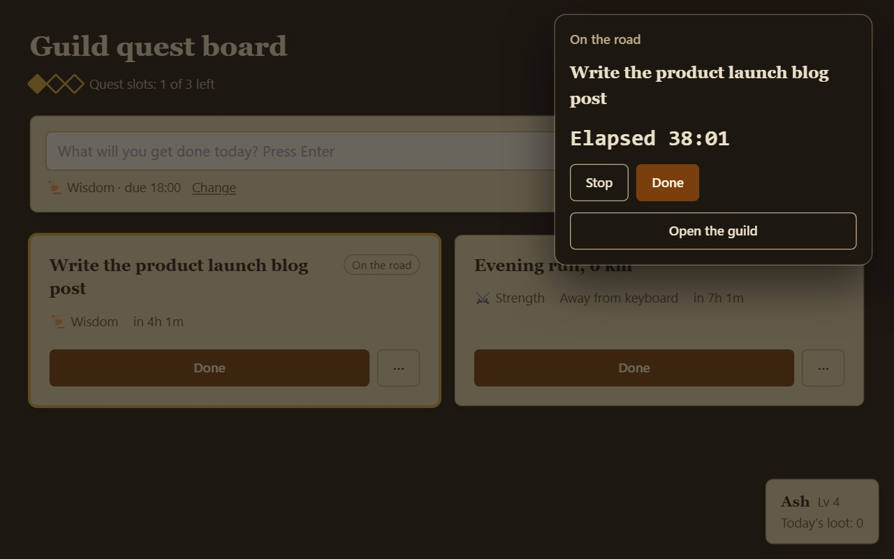

  <b>English</b> · <a href="README.zh-CN.md">简体中文</a> · <a href="README.zh-TW.md">繁體中文</a> · <a href="README.ja.md">日本語</a> · <a href="README.ko.md">한국어</a> · <a href="README.es.md">Español</a> · <a href="README.fr.md">Français</a> · <a href="README.de.md">Deutsch</a> · <a href="README.pt-BR.md">Português (Brasil)</a> · <a href="README.ru.md">Русский</a> · <a href="README.it.md">Italiano</a> · <a href="README.ar.md">العربية</a> · <a href="README.hi.md">हिन्दी</a> · <a href="README.id.md">Bahasa Indonesia</a> · <a href="README.vi.md">Tiếng Việt</a> · <a href="README.tr.md">Türkçe</a> · <a href="README.th.md">ไทย</a> · <a href="README.pl.md">Polski</a> · <a href="README.nl.md">Nederlands</a> · <a href="README.uk.md">Українська</a>

  

<h1 align="center">DoDodo</h1>

  <b>Your to-do list, turned into an adventurers' guild.</b> 
  Take a few quests in the morning, do the work, and every evening your adventurer comes home a little stronger.

  
  
  
  

  
   
  <a href="assets/demo.mp4">▶ Watch the full demo (MP4, 32 s)</a>

## Why DoDodo

You plan three things for the day and finish none. Often it isn't focus that's missing — it's a reason that feels real *right now*. A salary is far away; "+50 if you finish this today" works instantly.

DoDodo gives every task that instant payoff. Each quest you finish grows an adventurer who lives a small life of their own: new talents, chance encounters, a story that unfolds over a month. Skip a quest and you'll see the opportunity your adventurer missed. You never lose what you've already earned.

## How it works

1. **Take a quest** — type what you'll do and press Enter. DoDodo guesses the attribute (strength, wisdom, charisma, craft) and sets the deadline to the end of your work day.
2. **Start** — DoDodo quietly notes which site you're on while the quest runs. Away-from-keyboard quests (a run, groceries) need no tracking.
3. **Done** — one tap. DoDodo only asks a question if you barely focused.
4. **Come home** — after work, the guild settles the day: XP, level-ups, life events and missed opportunities.

## Screenshots

| Guild board | Evening settlement |
| --- | --- |
|  |  |
| **Your progress** | **Toolbar popup** |
|  |  |

## Features

- **One-line quests** — no forms. Up to three a day, so the plan stays honest.
- **Real focus, not checkboxes** — growth comes from time actually spent on the work.
- **A story worth coming back to** — chapter one unfolds over about 30 days, hand-written, no AI filler.
- **Proof you're changing** — seven-day focus chart, on-time rate, and the hour you get distracted most.
- **Fair by design** — no buying XP, no shortcuts, no streak shaming.

## Private by design

- Everything stays in your browser's local database. DoDodo never connects to the internet.
- Only the **domain** of the active tab is recorded, and only while a quest is running — never full URLs, page titles or page content.
- No account, no analytics, no ads. Export or delete all your data from Settings in one click.
- Full policy: [Privacy policy](https://github.com/hannnnnnnny/dodo-privacy/blob/main/PRIVACY.md)

## Get it

[**Add DoDodo to Chrome →**](https://chromewebstore.google.com/detail/iolnnoehfplknoagflegplkapoemiecc)  
Works in Chrome and Microsoft Edge (version 102 or later).

## About this repository

This repository is the public showcase for DoDodo: the introduction, demo and screenshots. The source code is not published here.  
Ideas, bugs or questions? [Open an issue](https://github.com/hannnnnnnny/DoDodo/issues) or email harryhaber606@gmail.com.

© 2026 DoDodo. All rights reserved.
